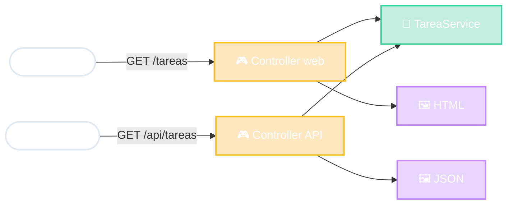

# Misma app, otra Vista

el dominio no se entera

<!--
- Mismo sistema de tareas, dos "presentaciones":
  - Para personas: Controller que devuelve una plantilla HTML (render server).
  - Para máquinas: Controller que devuelve JSON. En Spring: @Controller vs @RestController.
- Los dos usan el MISMO TareaService. El dominio no sabe si del otro lado hay una persona o un programa.
- Prueba de buen diseño en capas: si para agregar la API tuve que tocar el dominio, algo estaba mal separado.
- Y la SPA de la slide anterior (Gmail, Maps) es justamente un cliente de una API.
-->
