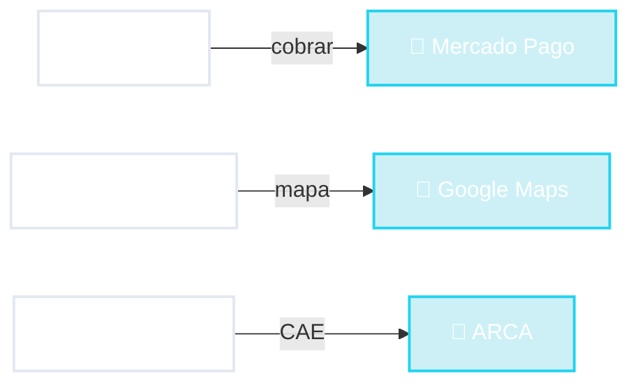

# 🔌 APIs

<span class="kicker">Una interfaz para máquinas</span>

```json
{
  "id": 42,
  "titulo": "Estudiar MVC",
  "hecha": false
}
```

<div class="kw-row mt-4">
<span class="kw">JSON</span>
<span class="kw">contrato</span>
<span class="kw">sin diseño visual</span>
</div>

::right::



<!--
- API = Application Programming Interface. Es una "capa de presentación" cuyo usuario NO es una persona: es otro programa.
- No hay botones ni colores. Hay datos con un formato acordado (casi siempre JSON sobre HTTP).
- Ejemplos concretos:
  - Una tienda online no programa su propio cobro con tarjeta: le habla a la API de Mercado Pago.
  - Una inmobiliaria muestra un mapa usando la API de Google Maps.
  - Un sistema de facturación le pide a ARCA (ex AFIP) el CAE de la factura electrónica.
  - "Iniciar sesión con Google" también es una API.
- Lo más importante: es un CONTRATO. Si cambio el nombre de un campo, rompo los programas de otros. Por eso las APIs se documentan y se versionan (/v1, /v2).
- Conexión con la CLI: la CLI también era fácil de automatizar. La API es la versión "en red" de esa idea.
-->
