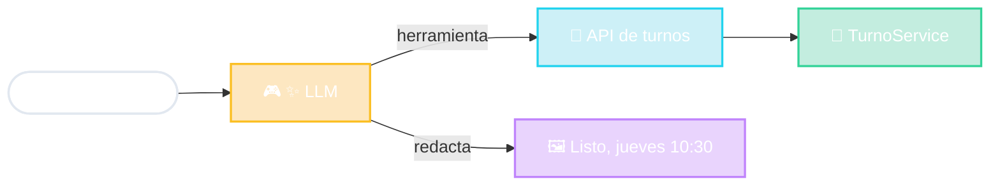

# Asistente con IA en MVC

El Controlador entiende lenguaje

la IA usa nuestras APIs
el dominio decide

<!--
- El gran cambio está en el Controlador: en vez de un "if comando == /turnos", hay un modelo de lenguaje que interpreta qué quiso decir el usuario y elige qué herramienta usar.
- Las herramientas son... APIs. Las mismas que vimos para "usuarios no humanos". El asistente es un usuario no humano más. Hay estándares para conectarlas, como MCP (Model Context Protocol).
- El Modelo (el dominio) sigue mandando: si el jueves no hay turnos, TurnoService lo rechaza, no importa lo que diga la IA. Las reglas de negocio NO se delegan al LLM.
- La Vista es texto generado: el LLM redacta la respuesta con los datos que devolvió la API.
- Mensaje de diseño: si mi sistema tiene un dominio bien separado y buenas APIs, conectarle un asistente con IA es "una cara más".
- Pregunta para la clase: ¿qué riesgo hay si la IA llama a una API de "borrar cuenta"? → permisos, confirmación del usuario, el dominio valida.
-->
