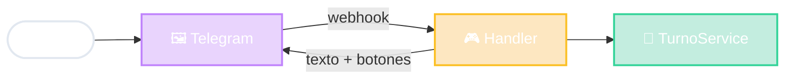

# Bot de Telegram en MVC

La Vista es prestada

Telegram dibuja
yo decido
mismo dominio

<!--
- Flujo:
  1. El usuario escribe /turnos en Telegram.
  2. Los servidores de Telegram le avisan a NUESTRO servidor con un pedido HTTP (webhook) que trae el mensaje en JSON.
  3. Nuestro Controlador (el "handler" del comando) decide qué hacer y usa el dominio: TurnoService, el mismo que usaría la web.
  4. Respondemos con texto y botones; Telegram se encarga de dibujarlos en cada celular.
- La Vista es "prestada": no programamos pantallas, Telegram ya sabe mostrar mensajes y botones en Android, iOS y web. Nosotros solo decimos QUÉ mostrar.
- Dato interesante: para Telegram, nuestro bot es... un cliente de su API (Bot API). Y nuestro servidor recibe webhooks: una API para que Telegram nos hable. Todo lo que vimos se combina.
- Otra vez: agregar un bot NO debería obligar a tocar el dominio.
-->
