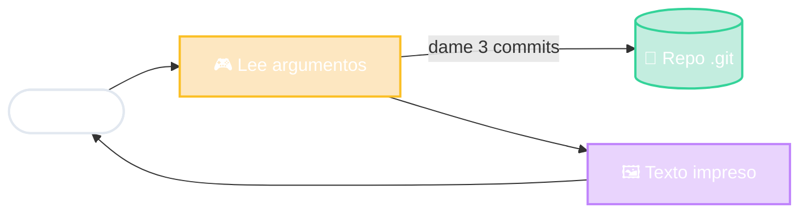

# `git log` en MVC

Mismo .git
→
GitHub web
VS Code
GitKraken

<!--
- Controlador: la parte de git que interpreta "log -3" y decide qué hacer.
- Modelo: la carpeta .git (commits, ramas). Ahí están las reglas: qué es un commit, cómo se encadenan.
- Vista: el formato del texto que se imprime (con --oneline cambia la vista, NO el modelo).
- Ejemplo de que el Modelo se queda: el mismo repositorio .git lo ves desde GitHub web, desde el panel de VS Code o desde GitKraken. Muchas vistas, un solo modelo.
- Pregunta para la clase: si agrego `--graph`, ¿qué letra cambié? → la Vista.
-->
