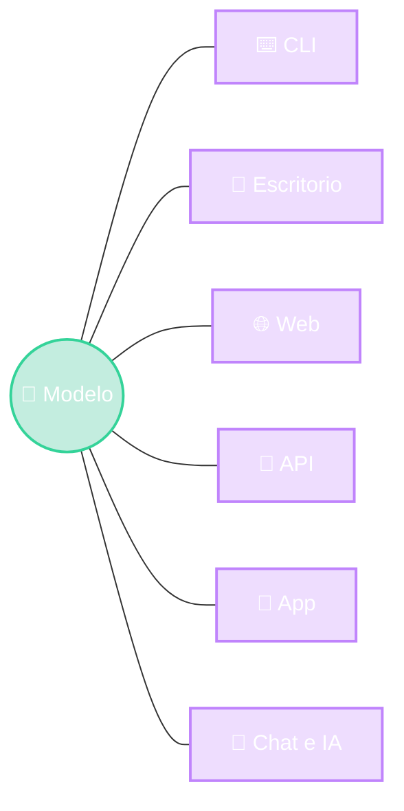

# Para llevarse

1. Separar la Vista
2. El Modelo no cambia
3. Elegir según el usuario

::right::

<!--
- Tres ideas:
  1. La presentación es una capa separada. MVC nos ayuda a ordenarla.
  2. Si el dominio está bien separado, puedo agregar una cara nueva (una API, una app) sin tocarlo.
  3. No hay interfaz mejor en abstracto: depende de quién la usa y para qué.
- Pregunta de cierre para la clase: un sistema de control de stock para un depósito donde los operarios escanean cajas y a veces no hay WiFi. ¿Qué interfaz eligen? (Respuesta esperable: app móvil nativa que funcione offline + API en el servidor; y quizás una web con render server para la oficina.)
-->
