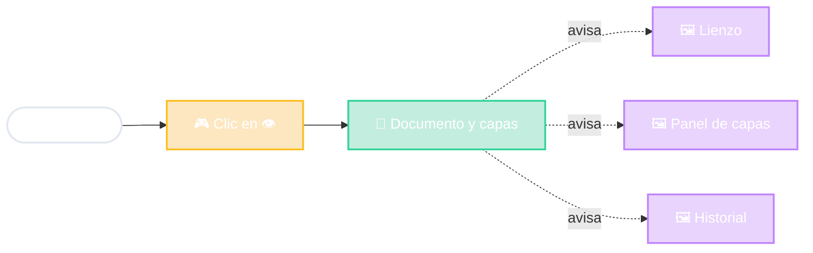

# Photoshop en MVC

Un Modelo, muchas Vistas

el Modelo avisa "cambié"
cada Vista se actualiza

<!--
- Este es el MVC "original" de Smalltalk, pensado justamente para interfaces gráficas.
- Ocultar una capa: el Controlador recibe el clic y le dice al Modelo "capa Logo: oculta".
- El Modelo cambia y AVISA a todos los interesados (patrón Observer). Tres vistas distintas se actualizan solas:
  - el lienzo deja de mostrar el logo,
  - el panel de capas muestra el ojito tachado,
  - el historial agrega "Ocultar capa" (para poder deshacer).
- Ejemplo más cotidiano: Excel. Cambiás un número en una celda y el gráfico que usa esa celda se redibuja solo. Celda y gráfico = dos vistas del mismo modelo.
-->
