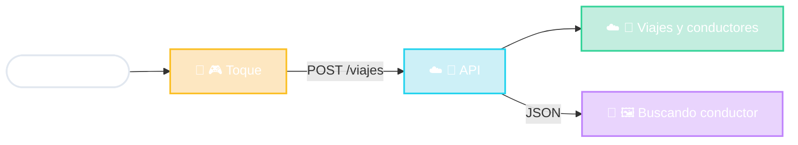

# Uber en MVC

Vista en el teléfono
Modelo en el servidor
API en el medio

<!--
- Tocás "Confirmar viaje":
  1. El Controlador (en el teléfono) toma el toque y la ubicación del GPS.
  2. Llama a la API del servidor: POST /viajes con un JSON.
  3. El Modelo (en el servidor) aplica las reglas: busca conductores cerca, calcula precio.
  4. Responde JSON y la Vista del teléfono muestra "Buscando conductor...".
- Es como la SPA web, pero la Vista está hecha con componentes nativos del teléfono.
- Detalle: el servidor de Uber tiene UNA API que usan la app de Android, la de iOS, la web y la app de los conductores. Otra vez: muchas vistas, un modelo.
-->
