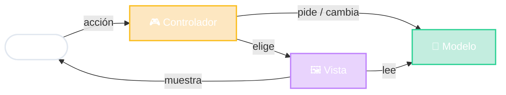

# MVC: Modelo · Vista · Controlador

🧠 Modelo = qué sé
🖼️ Vista = qué muestro
🎮 Controlador = qué hago

<!--
- Origen: Trygve Reenskaug, Xerox PARC, 1979, para Smalltalk-80. Tiene casi 50 años y sigue vigente.
- Analogía del restaurante:
  - Controlador = el mozo: recibe el pedido y sabe a quién pasárselo.
  - Modelo = la cocina: tiene los ingredientes y sabe cocinar (las reglas).
  - Vista = el emplatado: cómo te llega lo que pediste.
- Idea central: separar lo que se MUESTRA de lo que se SABE. Si mañana cambio el emplatado, la cocina no se entera.
- Recordar los colores: verde Modelo, violeta Vista, ámbar Controlador. Se repiten en toda la clase.
-->
