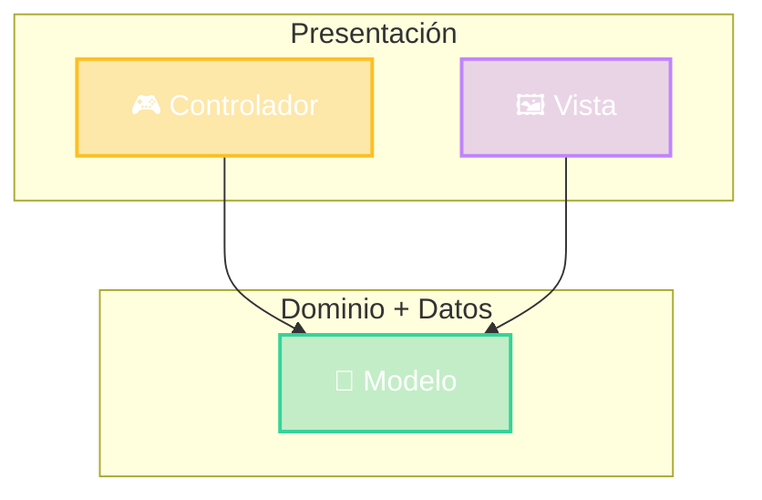

# MVC y las capas

¿Dónde vive cada letra?

V + C → Presentación
M → puerta al Dominio

Cambia la cara. El Modelo se queda.

::right::

<!--
- MVC NO es una arquitectura de todo el sistema: es un patrón para organizar la capa de presentación.
- Vista y Controlador viven en Presentación. El "Modelo" es lo que la presentación ve del dominio (en Spring: los Services y las entidades).
- Frase para que se lleven: "cambia la cara, el Modelo se queda". En cada tipo de app vamos a ver que cambian V y C, pero M es el mismo.
-->
