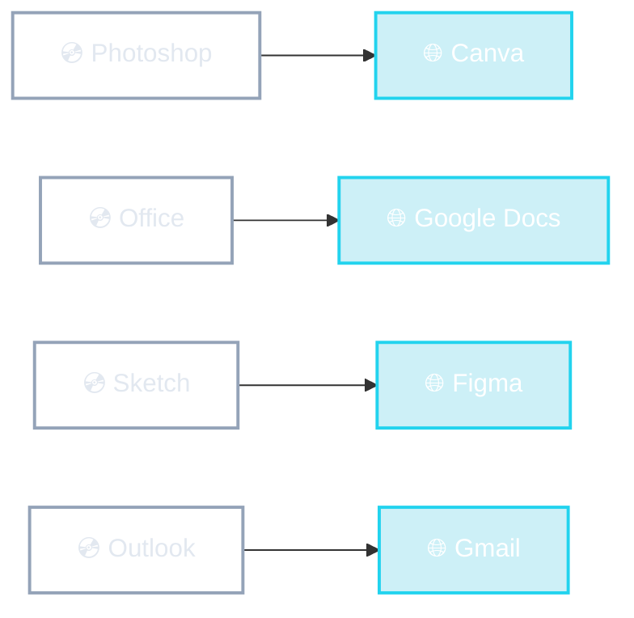

# De la caja al navegador

<!--
- Ejemplos concretos de apps que eran de escritorio y hoy tienen su versión web (o fueron reemplazadas por una web):
  - Adobe sacó Photoshop para navegador (Photoshop web); Canva es 100% web y le comió mercado a herramientas de diseño simples.
  - Office → Office 365 / Google Docs: el caso más claro de colaboración en vivo.
  - Sketch (solo Mac, escritorio) perdió contra Figma (web, colaborativo). Caso de estudio famoso.
  - Outlook / Thunderbird → Gmail.
- Notar que las versiones web suelen usar render en el cliente (mucha interacción), con un servidor que les da los datos.
-->
