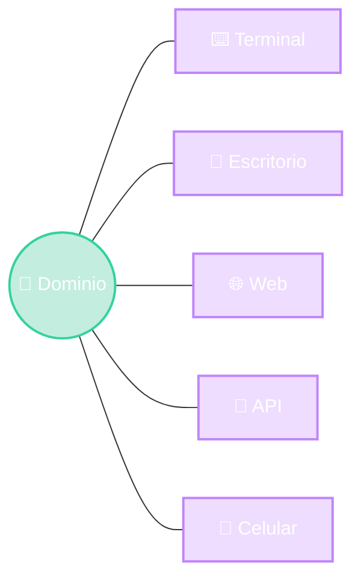

# Interfaces de Usuario

Del comando de texto al render server

Modelo
Vista
Controlador

<strong class="text-white">Ezequiel Sosa</strong> · Diseño de Software

::right::

<!--
- Clase sobre la capa de presentación: cómo un mismo sistema "se muestra" de muchas formas.
- Hilo conductor de toda la clase: MVC. Los colores se repiten en todos los diagramas: verde = Modelo, violeta = Vista, ámbar = Controlador.
- Recorrido: terminal → escritorio → web (render server) → APIs → celular.
-->
