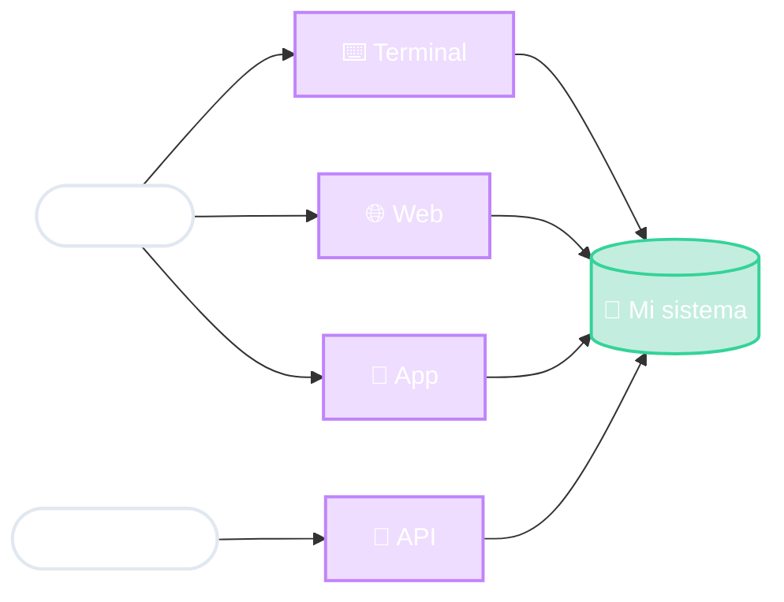

# ¿Quién usa nuestro sistema?

Pregunta inicial

<!--
- Preguntar: ¿de cuántas formas usan su banco? Web, app del celular, cajero automático, y cuando pagan con Mercado Pago, otro sistema le habla al banco (API).
- Es el MISMO banco, las mismas cuentas, las mismas reglas. Lo que cambia es la "cara".
- Ojo: no todos los usuarios son personas. Un sistema que consume a otro también es un "usuario".
-->
