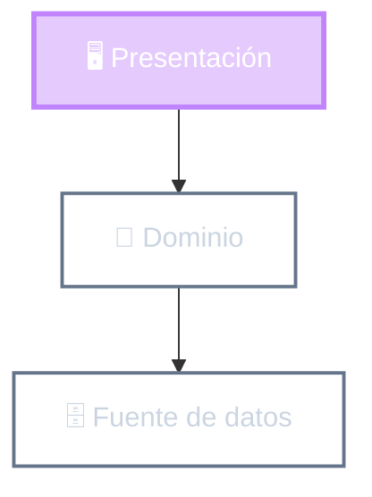

# Las capas de Fowler

Recordatorio

👉 Hoy: Presentación
Dominio
Fuente de datos

::right::

<!--
- Repaso rápido de las tres capas que ya vieron:
  - Presentación: cómo el usuario interactúa con el sistema.
  - Dominio: las reglas del negocio (qué es una venta, cuándo se aplica un descuento).
  - Fuente de datos: dónde y cómo se guarda (base de datos, archivos, otros servicios).
- Las dependencias van hacia abajo: la presentación conoce al dominio, el dominio NO conoce a la presentación.
- Hoy nos concentramos en la capa de arriba.
-->
