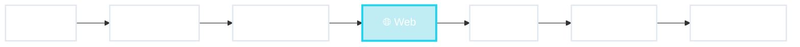

# El recorrido de hoy

De la terminal a la IA

⭐ foco: render server

<!--
- Es más o menos un orden histórico, pero todas siguen existiendo hoy.
- En cada parada: (1) ejemplo concreto, (2) dónde está la M, la V y la C.
- La parada más larga es la Web con render en el servidor.
-->
