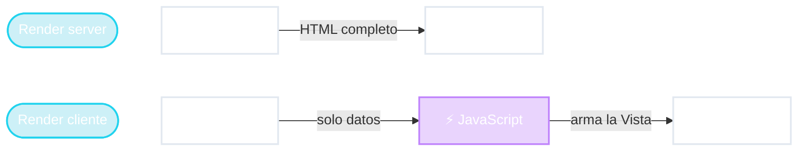

# La Vista se muda al navegador

Gmail
Google Maps
Figma
React · Angular · Vue

<!--
- Con JavaScript aparece otra opción: el servidor manda SOLO LOS DATOS y el JavaScript en el navegador arma la vista.
- Ejemplo: Google Maps. Arrastrás el mapa y aparecen calles nuevas SIN recargar la página. El JS pide al servidor "dame los datos de esta zona" y dibuja.
- Gmail: abrís un mail y no se recarga toda la página, solo cambia el panel.
- Se las llama SPA (Single Page Application). Herramientas: React, Angular, Vue.
- En MVC: la Vista (y parte del Controlador) se mudó al navegador. El Modelo sigue en el servidor.
- Hoy se combinan ambas: primera carga renderizada en el servidor (rápida, buena para Google) y después JS toma el control (Next.js, Nuxt). No hace falta entrar en eso.
- Pregunta: si el servidor ahora manda "solo datos", ¿no es eso para lo que sirve una API? → Sí, ya llegamos.
-->
