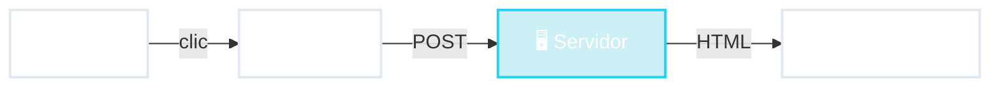

# Cada clic = página nueva

✅ simple
✅ cliente liviano
✅ Google lo lee

⚠️ recarga todo
⚠️ cada acción viaja

<!--
- Cada interacción (un clic en un link, enviar un formulario) viaja al servidor y vuelve una página ENTERA nueva. Se ve el "parpadeo" de la recarga.
- Ventajas:
  - Simple de programar y de razonar: todo está en un solo lugar.
  - Funciona en cualquier navegador, incluso en PCs o celulares viejos.
  - Los buscadores (Google) leen el HTML directamente → bueno para SEO.
  - Actualizar = cambiar el servidor. Todos los usuarios ven la versión nueva al instante.
- Desventajas: cada acción tarda un viaje de red; para cosas muy interactivas (arrastrar, dibujar) no alcanza.
- Ejemplos: Wikipedia, sistemas de gestión universitaria (tipo SIU Guaraní), muchos homebanking y sistemas internos de empresas.
-->
