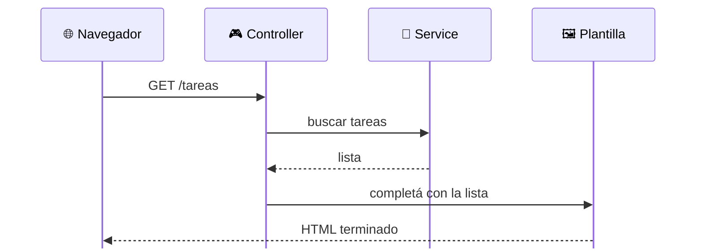

# ⭐ Render en el servidor

El servidor arma la página completa

<!--
- Esta es la idea central de la clase.
- Paso a paso con una app de tareas (la misma de la clase de Spring Boot):
  1. El navegador pide /tareas.
  2. El Controller recibe el pedido (como los @Controller de Spring).
  3. Le pide los datos al Service (capa de dominio, que a su vez usa el Repository).
  4. Con esos datos completa una PLANTILLA: un HTML con huecos.
  5. Al navegador le llega un HTML terminado, listo para mostrar.
- El navegador no ejecuta nada de nuestra lógica. No sabe que existe Java. Solo dibuja HTML.
- "Render" = dibujar / generar lo que se muestra. "Server-side rendering" = se genera en el servidor.
-->
