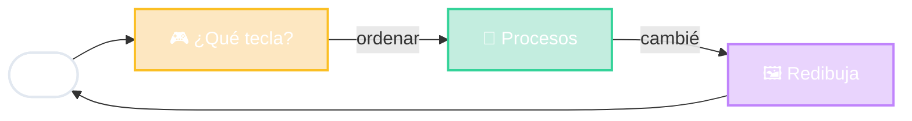

# htop en MVC

🔁 esperar
→
reaccionar
→
redibujar

<!--
- Aparece el "bucle de eventos": el programa espera una tecla, la procesa y vuelve a dibujar. Para siempre, hasta F10.
- Controlador: el código que dice "F6 = ordenar, F9 = matar proceso".
- Modelo: la lista de procesos del sistema operativo.
- Vista: el dibujo en pantalla.
- Detalle interesante: el Modelo cambia SOLO (aparecen y mueren procesos). Por eso la flecha "cambié" va del Modelo a la Vista: la vista se actualiza cada segundo aunque nadie toque nada.
-->
