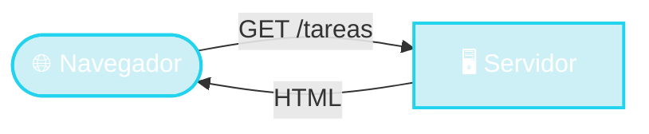

# 🌐 La Web

El navegador: un cliente universal

instalar = escribir una URL

<!--
- Ya lo vieron en la clase de HTTP: el navegador pide, el servidor responde.
- Todos los sistemas operativos ya traen un navegador. El navegador sabe "dibujar" HTML.
- Entonces: si mi programa genera HTML, cualquiera con un navegador lo puede usar. Sin instalar nada.
- Pregunta clave para lo que sigue: ¿quién arma ese HTML? → El servidor. Eso es el "render en el servidor".
-->
