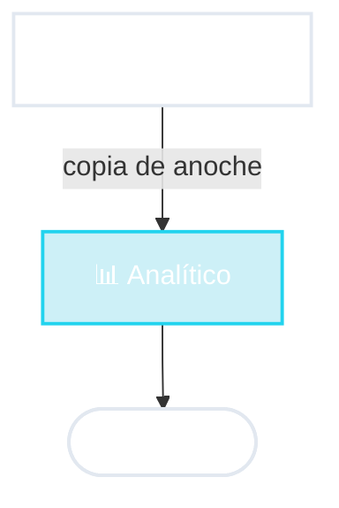

# 📊 Analítica

El tablero de la gerencia

::right::

Ventas 2025 por provincia

Buenos Aires

Córdoba

Santa Fe

Mendoza

Tucumán

<!--
- Caso de uso: la gerencia de una cadena de supermercados abre un tablero con las ventas del año por provincia, por categoría, comparadas con el año anterior.
- ¿Por qué un sistema aparte? Si esa consulta enorme corriera sobre el mismo sistema que registra las ventas, podría ponerlo lento justo cuando los clientes están pagando en la caja. Las dos cosas compiten por los mismos recursos.
- Entonces se separan: el transaccional registra; periódicamente (por ejemplo, todas las noches) se copian los datos al analítico, que está organizado para responder preguntas grandes.
- ¿Quién hace esa copia nocturna? ¡Un proceso batch! Los tipos se combinan.
- Consecuencia: el tablero muestra los datos "de ayer". Para la mayoría de las decisiones de negocio, alcanza.
-->
