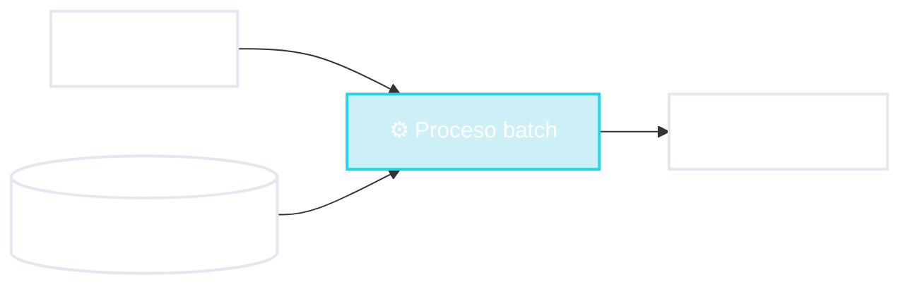

# 🗓️ Batch

Todo junto, de una vez, a la noche

💰 liquidación de sueldos
🏦 intereses de plazos fijos
💡 facturas de luz del mes

<!--
- Batch = lote. Procesa una gran cantidad de datos de una sola vez, normalmente disparado por un HORARIO (todas las noches a las 2, el último día del mes).
- Casos de uso:
  - Liquidación de sueldos: a fin de mes, para cada empleado, calcular sueldo, descuentos, aportes, y generar los recibos y el archivo para el banco.
  - Cierre diario del banco: a la noche, calcular los intereses de TODOS los plazos fijos.
  - La empresa de luz genera millones de facturas una vez por mes.
- ¿Por qué no hacerlo de a uno, en el momento? Porque procesar todo junto es mucho más eficiente, y porque muchas reglas son "por período" (el mes, el día).
- ¿Por qué a la noche? Para no competir por los recursos con los usuarios que usan la web durante el día.
-->
