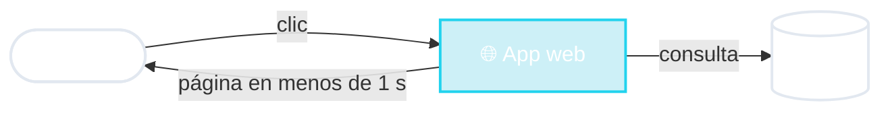

# 🌐 Aplicación web

Una persona, un navegador, una respuesta ya

🏦 consultar saldo
🛒 buscar en MercadoLibre
🎓 inscribirse a materias

<!--
- Una persona usa un navegador. Hace clic, la aplicación hace una consulta (lee o escribe pocos datos) y devuelve una página.
- Casos de uso claros:
  - Consultar el saldo en el homebanking.
  - Buscar "zapatillas" en MercadoLibre.
  - Inscribirse a materias en el sistema de la facultad.
- Lo que la define: hay una persona MIRANDO la pantalla. Se suele citar que si una página tarda más de unos 3 segundos, una buena parte de los usuarios se va.
- Otra característica: picos. El día de inscripción a materias o en un Hot Sale, la carga se multiplica en minutos.
-->
