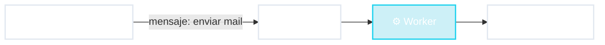

# 📨 Worker de mensajes

Hacelo después, yo sigo

📧 mail de confirmación
🎬 "procesando video..."
🧾 factura electrónica

<!--
- Un worker es una aplicación SIN pantalla y SIN pedidos directos: recibe mensajes del tipo "hay que hacer tal trabajo" y los procesa cuando puede.
- El "buzón" es un lugar donde quedan los mensajes esperando. No vamos a ver cómo funciona por dentro (eso es infraestructura); alcanza con saber que el mensaje no se pierde.
- Casos de uso:
  - Comprás algo: la web te dice "¡Compra confirmada!" al instante, y el mail llega un minuto después. Ese mail lo mandó un worker.
  - Subís un video a YouTube: aparece "procesando". Un worker lo está convirtiendo a distintas calidades (360p, 720p, 1080p). Puede tardar minutos.
  - Pedir la factura electrónica al fisco: si el servicio tarda o está caído, el worker reintenta más tarde sin molestar al cliente.
- Idea clave: sacamos el trabajo lento o poco confiable del camino de la persona que espera.
-->
